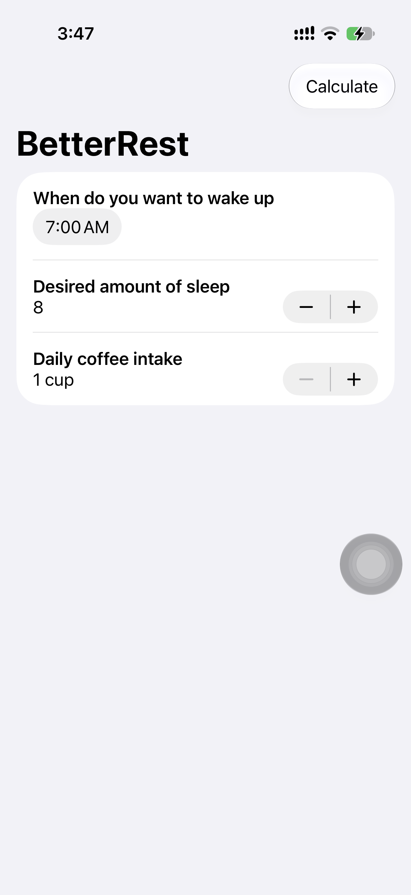

# BetterRest 🌙☕️

An intuitive iOS app built with **SwiftUI** and **Core ML** that calculates the optimal bedtime for a great night's sleep.

BetterRest uses a trained machine learning model to predict how much sleep a user actually needs based on their target wake-up time, desired sleep duration, and daily coffee intake.

---

## 📱 Preview

<p align="center">
  
</p>

---

## ✨ Features

- **Core ML & Create ML**: Uses a trained tabular regression model (`SleepCalculator.mlpackage`) to compute accurate bedtime recommendations on-device.
- **Dynamic Bedtime Calculation**: Calculates bedtime by subtracting predicted actual sleep debt from target wake-up time.
- **Smart Grammar Inflection**: Employs SwiftUI's automatic markdown pluralization (`^[1 cup](inflect: true)`) for seamless localization and natural phrasing.
- **Native SwiftUI Components**:
  - `DatePicker` with `.hourAndMinute` component formatting.
  - `Stepper` with custom value formatting and ranges.
  - `Form` and `NavigationStack` for a clean iOS design system.
  - User feedback delivered via contextual native alerts.

---

## 🛠️ Tech Stack & Requirements

- **Language:** Swift
- **UI Framework:** SwiftUI
- **Machine Learning:** Core ML / Create ML
- **Platform:** iOS 17.0+
- **IDE:** Xcode 15+

---

## 🚀 Getting Started

1. **Clone the repository:**
   ```bash
   git clone git@github.com:selva7378/BetterRest.git
   cd BetterRest
   ```
2. **Open in Xcode:**
   ```bash
   open BetterRest.xcodeproj
   ```
3. **Build & Run:**
   - Select an iOS Simulator or connected physical device.
   - Press `Cmd + R` to run.

---

## 📚 Acknowledgments

Project built as part of Paul Hudson's **[100 Days of SwiftUI](https://www.hackingwithswift.com/100/swiftui)** (Project 4: BetterRest).
